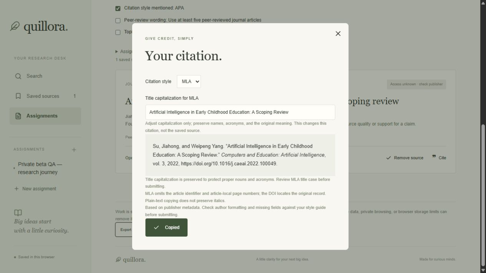

# Private beta QA report

Baseline: d692764. Development branch: codex/private-beta-qa. The starting tree was clean; main is retained. No AGENTS.md was found at the project or checked ancestors. Existing documentation and tests were read before edits. There are no credentials, cloud migrations, new scholarly provider integrations, paid APIs, or deployments in this branch.

## Evidence and coverage

The committed [corpus](../tests/fixtures/scholarly/README.md) contains **49 distinct real scholarly journal DOI records** from individual Crossref endpoints, with retrieval URLs/timestamps and hashes. Coverage includes seven explicit article numbers, one naturally absent author list, seven missing issues, eleven author lists longer than twenty, Unicode names, scientific typography, title-case/sentence-case metadata and DOI variants. No full texts or abstracts were collected. Synthetic missing-field perturbations are marked as omissions of a real record and are not counted as additional sources.

The corpus tests verify source identity, checksum integrity, normalization, backup round trips and APA/MLA output invariants for all 49. Those are not 49 independently certified citations. Four selected exact-output cases are independently constructed against official APA 7 journal examples and MLA 9 public core-element guidance, with reviewed title capitalization explicitly stated. [APA journal references](https://apastyle.apa.org/style-grammar-guidelines/references/examples/journal-article-references), [MLA ninth-edition core examples](https://style.mla.org/works-cited/citations-by-format/). DOI metadata can differ from a style-guide example in capitalization or journal spelling; the app preserves supplied facts and exposes warnings rather than silently rewriting proper nouns.

The public MLA article-number answer available for consultation is explicitly marked as eighth-edition material. Current public MLA 9 examples support the core template, author order and missing-element treatment; this pass does not claim exhaustive verification against the entire licensed MLA 9 handbook. [Article-number guidance](https://style.mla.org/journals-with-article-numbers/). A librarian/style reviewer remains a beta entry gate for edge cases and abbreviated page ranges.

## Confirmed defects corrected

| Trigger at baseline | Correction | Regression evidence |
|---|---|---|
| A Crossref title or journal is a scalar instead of an array | Keep its full text; do not take the first character | scholarly.test.ts; mixed-record route test |
| Missing/malformed optional author, abstract, date or number fields | Normalize defensive shapes; keep usable records; fail plainly if the response contains no usable records | scholarly.test.ts, search.test.ts |
| Entity-encoded/scientific titles such as CO-subscript-2 or beta entities | Decode entities and strip only markup, preserving readable text | scholarly.test.ts |
| DOI prefixes, surrounding whitespace, uppercase resolver URLs, encoded DOI separators | Canonicalize for citation URLs, imports and deduplication | scholarly.test.ts |
| A PLOS e-locator appears only in the page field | APA labels it Article; MLA does not mislabel it as a page | corpus official PLOS case |
| A title ends with quotation marks, or contains nested double quotes in MLA | Put terminal punctuation inside closing quotes; use single inner quotation marks | APA PLOS exact case; MLA nested-quote case |
| User needs APA sentence case and MLA title case without corrupting proper nouns | Existing citation dialog permits a style-local capitalization edit; source metadata is not changed, and closing/reopening the dialog resets this transient edit | component test and browser clipboard reads |
| Slow rubric upload finishes after switching assignment/editing text | Ignore obsolete completion/error using a request sequence | storage-ui.test.ts |
| Older backup file finishes reading after a newer selection | Keep only the newest import preview | storage-ui.test.ts |
| Cooperating tabs pass the old snapshot check simultaneously | Serialize compare/write with Web Locks, then reject stale snapshots; bounded five-second lock wait | coordination.test.ts; sequential real-browser stale-tab check |

Access remains unknown, peer review remains unknown and credibility remains unassessed. Cards now say journal record rather than implying every record is a full journal research article. Topic-match wording explicitly disclaims quality and claim-support verification. Licenses, citation counts, indexing, journal names and backup-provided access flags are not promoted into verified badges.

## Automated checks

- Run npm ci with Node.js 24, then npm test. The complete default suite contains **118 tests**, including the existing 50 and new corpus, normalization, concurrent-lock, stale-request and title-edit regressions.
- npm run build verifies production bundling, lint, TypeScript and route generation. npx tsc --noEmit can be run separately.
- StoragePort/JSDOM quota and security-policy failures are **controlled simulations**. They assert byte-preservation, unchanged saved UI, attempted-change export/retry controls, source removal, assignment changes, import failure messaging, and checklist recovery. They do not fill a real browser disk quota.
- The simultaneous-tab test injects a queued lock manager and races two writes from the same snapshot: exactly one succeeds and the other becomes a conflict. It does not claim a full real-browser simultaneous race stress test.
- The stale-search test explicitly resolves a newer search before an older request. Separate tests resolve stale rubric and backup reads after a context/selection change.
- Dataset acquisition is opt-in: node scripts/refresh-scholarly-dataset.mjs. It resumes snapshots, paces calls, respects bounded rate-limit backoff and records failures. Initial parallel collection hit 429; paced sequential collection completed 49 records. Never change frozen data as part of the ordinary test command.

## Browser workflow checked

Used localhost:3005, a separate origin from the student's existing localhost:3002 data. Only synthetic assignment instructions and public article metadata were used.

1. Enter the early-childhood AI topic; upload tests/fixtures/rubric.pdf; inspect extracted instructions; confirm; create a named assignment.
2. Search Crossref; save the Su/Yang 2022 source; open Cite; copy APA and inspect clipboard; switch to MLA, correct only title capitalization, copy and inspect clipboard; switch back and verify APA's title is unaffected. The saved source retains its publisher title.
3. Manually check the citation-style requirement; refresh; verify source, rubric, question and check survive.
4. Open a second tab on the same test origin; edit/save the question in the first. Verify the second displays the stale-work message and disables checklist edits instead of overwriting newer work.
5. Close the second test tab; export a backup; remove the source; import and merge the backup; refresh; verify the edited question, rubric, source and checked item restore.

The PDF request completed after the browser tool's first short observation deadline; a subsequent observation confirmed extraction. This was not counted as a failed parser or replaced with invented text. PDF/DOCX integration tests exercise the same server endpoint. Clipboard checks inspect actual plain text; rich clipboard formatting is not implemented.

## Remaining risks / beta entry gates

**Do not describe this as a launched or cloud-backed student beta.** Before inviting students:

- Choose an authenticated private perimeter and user-data isolation strategy; no current production sign-in, server backup, cross-device sync, per-user authorization or rate limiting exists. Follow [the implementation plan](IMPLEMENTATION_PLAN.md).
- Arrange independent librarian review of APA 7/MLA 9 edge cases. Title capitalization is manual, group-name ambiguity and initials-only source names remain metadata-dependent; publisher titles are not guaranteed style-ready. Title edits are session-only and plain-text copies need italics applied in the destination. The app is still a citation draft aid.
- Web Locks coordinate this version's cooperating tabs on secure/supporting browsers only. Old app versions, unsupported browsers, browser extensions, external storage writers and two devices do not share that lock. Unsupported environments retain snapshot checking and display single-tab guidance. Use one editing tab in those environments. No multi-device transaction claim is made.
- Actual browser quota exhaustion, denial-policy matrices, crash/restart during a pending save, long-held-lock stress, mobile Safari/Firefox matrices, and low-memory/decompression abuse were not exercised end to end. Local test failures preserve saved work; pending failed drafts are memory-only until export or retry.
- The PDF/DOCX endpoint needs host-compatible request limits, time/memory/decompression bounds and abuse throttling before exposure. A 10 MB compressed DOCX cap does not bound its decompressed size. Scanned/encrypted PDFs can still require pasted text.
- Crossref registration can include abstracts, supplements, corrections and poor-quality deposits. No live publisher/OA/peer-review verification or retraction-screening service is implemented. Dataset membership is not an endorsement. Full-article summaries are not generated.

## Exact follow-up reproductions

- **Real quota:** use a disposable browser profile/origin, import checklist-workflow.json, export a baseline, fill separate temporary keys until actual quota, attempt save/edit/check/import, compare quillora-work before/after, remove only test keys, Retry save and refresh. Never use the student's normal saved-work origin.
- **Unsupported-lock fallback:** on a disposable origin/browser lacking Web Locks, save a synthetic assignment; verify single-tab guidance. Open two tabs and check stale-write rejection. Do not infer simultaneous atomicity from this fallback.
- **Long-held lock:** in a disposable test harness, hold quillora-work-write for longer than five seconds while a save queues. Confirm an actionable coordination failure and no write. This timeout boundary is implemented but not wall-clock browser-tested.
- **Capitalization:** import checklist-workflow.json; Cite -> MLA; revise the title capitalization in the existing field; copy; switch to APA and verify source wording remains intact. Reopen Cite and observe corrections reset. This is intentional transient behavior, not persisted metadata enrichment.
- **Stale async:** run node --import tsx --test tests/storage-ui.test.ts. Deferred responses simulate out-of-order search completion, rubric completion after an assignment switch and out-of-order backup reads.

Production integration on port 3006 passed valid PDF/DOCX extraction, invalid/unsupported/missing-upload errors, query validation, and three live searches with individual DOI-record comparisons. An initial rapid live run returned 503; direct diagnostics observed upstream 429. The live runner now paces requests and retries only 429/503 up to three attempts, recording transient statuses rather than substituting results.

Live provider results and billing terms change. Frozen tests are reproducible offline; live integration checks can fail when Crossref is rate-limited/unavailable and should report that separately. No fabricated fallback results are permitted.

Final validation for this branch: npm test passed all 118 tests; npm run build passed compilation, lint, TypeScript and route generation; npm audit --omit=dev reported no known production vulnerabilities. Production integration on port 3006 passed PDF/DOCX and three live searches after paced execution. Production browser smoke also restored the exported test assignment after refresh and verified MLA title correction/copying. These are local checks, not deployment verification.

